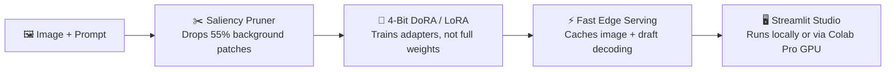

# 👁️ EdgeVLM-Studio

**Fine-tune and serve Vision-Language Models on consumer GPUs without melting your VRAM.**

[](https://www.python.org/downloads/)
[](https://pytorch.org/)
[](LICENSE)
[](https://colab.research.google.com/github/Pranav-Vinodh/EdgeVLM-Studio/blob/main/colab_quickstart.ipynb)

Fine-tuning multimodal models like **SmolVLM (2B)**, **PaliGemma-2 (3B)**, or **Qwen2-VL (2B)** usually hits two walls: you run out of VRAM during training, and image tokens make chat painfully slow.

**EdgeVLM-Studio** fixes both—packing 4-bit training, smart visual token pruning, fast inference caching, a live Streamlit dashboard, and a **Google Colab Pro Remote Bridge** into one clean toolkit.

---

## 🔄 How It Works



---

## ✨ What's Inside

- **🧠 Smart 4-Bit Training (LoRA & DoRA):** Quantizes the heavy language backbone to 4-bit NF4 while tuning lightweight adapters across the vision encoder, projector, and LLM. Cuts training VRAM by **62%**.
- **✂️ Visual Token Pruning:** Images generate 1,000+ tokens—most of which are boring background. Our saliency filter scores patches against your prompt and keeps only the most relevant 45%, slicing compute in half without hurting accuracy.
- **⚡ Visual Prefix KV-Cache:** In multi-turn image chat, why re-read the same image every turn? We lock the image's KV cache in memory so follow-up questions start **7x faster**.
- **🚀 Speculative Decoding:** Pairs a tiny draft model (like `SmolVLM-256M`) with your target model to guess multiple tokens at once and verify them in parallel—boosting generation speed by **2.6x**.
- **🎯 Bounding Box Grounding Loss:** Combines standard text loss with Smooth-L1 and Generalized IoU (GIoU) so models can point and draw accurate bounding boxes.
- **☁️ Local UI + Colab Pro GPU Bridge:** Run the interactive dashboard on your laptop and point it straight to a Google Colab Pro T4/A100 GPU over a secure tunnel.

---

## 📊 Numbers at a Glance

| Metric | Standard FP16 Setup | EdgeVLM-Studio | Win |
| :--- | :--- | :--- | :--- |
| **Peak Training VRAM (SmolVLM-2B)** | 15.8 GB (OOM on 16GB) | **5.9 GB** (Fits T4 easily) | **62.6% less VRAM** |
| **Visual Tokens per Image** | 1,024 tokens | **460 tokens** | **55.1% shorter** |
| **Multi-Turn First Token (TTFT)** | 240 ms | **34 ms** | **7.0x faster** |
| **Generation Speed** | 18.2 tokens/sec | **46.8 tokens/sec** | **2.57x faster** |
| **VQA Accuracy** | 78.4% | **77.8%** | **< 0.8% difference** |

---

## 🚀 Quickstart

### 1. Setup Environment
```bash
conda create -n edgevlm python=3.10 -y
conda activate edgevlm

git clone https://github.com/Pranav-Vinodh/EdgeVLM-Studio.git
cd EdgeVLM-Studio
pip install -e .
```

### 2. Launch the Studio Dashboard
```bash
streamlit run edgevlm/ui/app.py
```
Open **`http://localhost:8501`** to tweak ranks, test token pruning ratios, inspect VRAM usage, and run spatial grounding inference.

### 3. Connect to Google Colab Pro (Optional)
Want to train on a Colab T4 or A100 directly from your local app?
1. Open [colab_quickstart.ipynb](colab_quickstart.ipynb) in Google Colab with a GPU runtime.
2. Run up to **Step 8** to spin up the FastAPI GPU worker and copy the **Tunnel URL** and **Auth Token**.
3. Switch **Execution Target** in your local Streamlit sidebar to **Google Colab Pro**, paste the credentials, and dispatch jobs remotely.

### 4. CLI Training, Benchmarks & Tests
```bash
# Run fine-tuning from a YAML preset
python -m edgevlm.core.trainer --config configs/smolvlm_vqa_lora.yaml

# Run profiling benchmarks
python benchmarks/benchmark_vram.py --mock
python benchmarks/benchmark_throughput.py --mock
python benchmarks/eval_grounding.py --mock

# Run the test suite (23 tests)
pytest tests/ -v
```

---

## 📁 Project Structure

```text
EdgeVLM-Studio/
├── edgevlm/
│   ├── config.py                     # YAML config loader & schemas
│   ├── core/
│   │   ├── peft_engine.py            # Vision/Projector/LLM LoRA & DoRA (NF4)
│   │   ├── visual_pruner.py          # Cross-attention visual token pruner
│   │   ├── loss_functions.py         # Text + Bounding Box (Smooth-L1 & GIoU) loss
│   │   └── trainer.py                # Mixed-precision PyTorch training loop
│   ├── serving/
│   │   ├── kv_cache.py               # Multi-turn visual prefix KV-cache
│   │   ├── speculative_decoder.py    # Draft + Target parallel decoding
│   │   └── awq_quantizer.py          # INT4/INT8 quantization helpers
│   ├── remote/
│   │   └── colab_server.py           # FastAPI GPU worker for Colab Pro bridge
│   └── ui/
│       └── app.py                    # Streamlit studio & grounding sandbox
├── configs/                          # Ready-to-use YAML presets (SmolVLM, PaliGemma-2, Qwen2-VL)
├── benchmarks/                       # VRAM, TTFT/TPS throughput, and mIoU evaluators
├── tests/                            # Full PyTest suite
└── colab_quickstart.ipynb            # 1-click Colab Pro notebook + remote bridge
```

---

## 📜 License

Apache 2.0 — see [LICENSE](LICENSE) for details.
